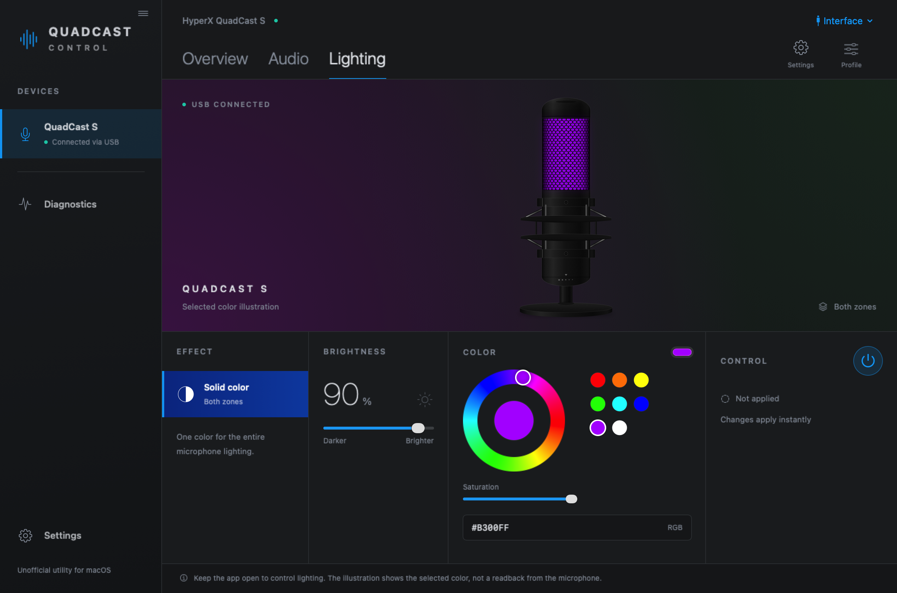

# QuadCastControl

Native macOS app for HyperX microphones, built with SwiftUI.

<picture>
  <source media="(prefers-color-scheme: dark)" srcset="Docs/Screenshots/lighting-dark.png">
  <source media="(prefers-color-scheme: light)" srcset="Docs/Screenshots/lighting-light.png">
  
</picture>

  <a href="Docs/Screenshots/lighting-dark.png">Dark appearance</a> ·
  <a href="Docs/Screenshots/lighting-light.png">Light appearance</a>
   
  Interface previews with a sample device. The microphone illustration shows the selected color.

**Work in progress.** Microphone discovery through CoreAudio and QuadCast S
HID discovery/binding are implemented, along with a live-color packet builder
and byte-level tests. QuadCast S supports a solid color picker, color presets,
brightness from 0–100%, and lighting off through a verified USB interface.
With **Lighting** on, choosing a color or changing brightness applies it
immediately; there is no Apply step. Opening the app does not change lighting. Keep the app open to maintain control; stopping it may
restore the microphone's own lighting. Animations and onboard saving are not
implemented yet. Other recognized models
currently have audio discovery only. Physical lighting behavior still needs
validation on each supported revision.

Choose **Settings → Appearance** to follow macOS or keep Light/Dark mode.
The choice is remembered between launches.

**Unofficial, not affiliated with HyperX/HP.**

## Build and run

Requires macOS 15 or later and Xcode 26 or later.

1. Open `QuadCastControl.xcodeproj` in Xcode.
2. Select the `QuadCastControl` scheme and your Mac.
3. Choose your signing team if needed, then Run.

App Sandbox USB access is enabled in the app's entitlements.

## Documentation

- [Console interface](Design/Interface.md)
- [Hardware protocol facts and research sources](Docs/PROTOCOL.md)
- [HID layer and mock transport](Design/HIDLayer.md)
- [Microphone discovery](Design/MicrophoneDiscovery.md)

## License

[MIT](LICENSE) — Copyright (c) 2026 ByteHasher.
